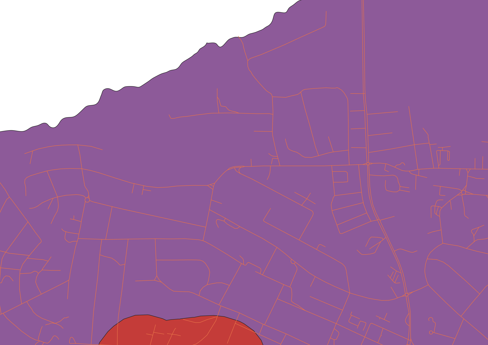

# My Geodev-Lab-Africa project
what areas of low elevation within Ibadan north local government within 200m of mapped water features?
Built over twelve month with Geo Dev Africa, Cohort one.
See Project-brief.md for the full brief.

## MONTH 2: DEVELOPMENT, ENVIRONMENT AND EARLY PYTHON
-Week 5: Set up Python, VS Code and the terminal. hello.py runs

-Week 6: Environments and Project Setup with uv

-Week 7: Python, the six ideas. analyse.py runs

-Week 8: Inspect_data.py summarizes low elevation areas in Ibadan North

-Week 9:  refactor function works summary.py runs

### Month 2 reflection: refactoring helps to reduce codes into manageable structure that is easy to work it without affecting the output. inputting the wrong data in csv file might affect the output of the terminal if the written code does not address it

## MONTH 3: GEOSPATIAL PYTHON AND AUTOMATION

